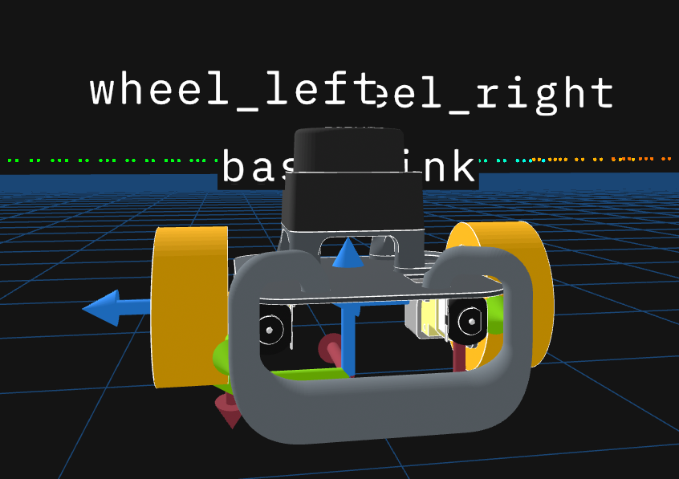
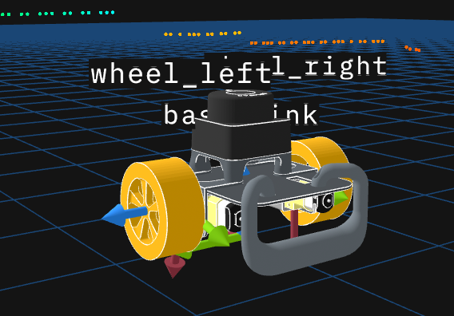
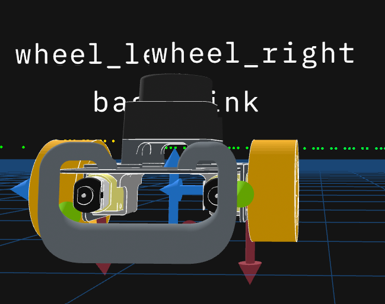
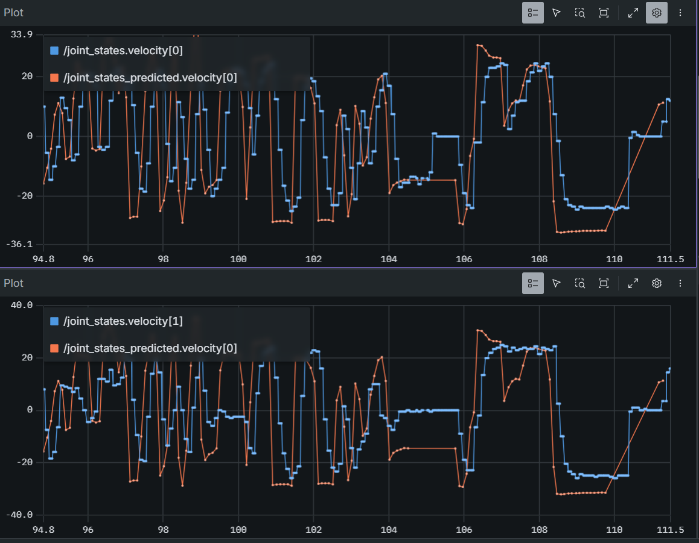
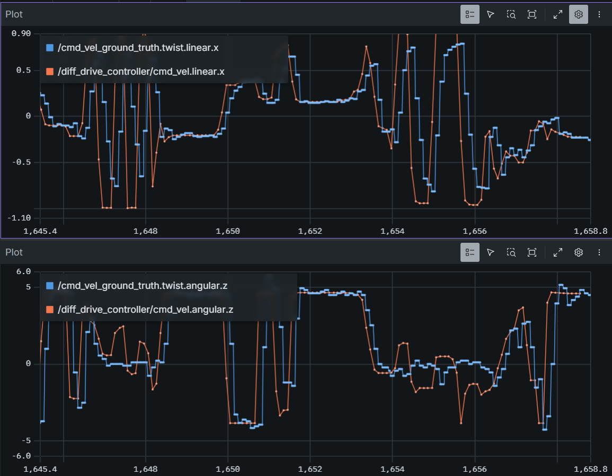

<!---
If you're new to markdown, check out this reference: https://www.markdownguide.org/basic-syntax/
-->

# Writeup

## Q0. Investigating Transforms in Foxglove (10 pts)

**Q0.1:**

Rover moves forward along the x (red) axis. As pictured above where the left wheel is to the left of the base_link axis and the right wheel is to the right and thus the x axis is pointing along the front.

When the rover moves forward, at the point of contact there is assumed to be a no slip condition and thus v_contact = 0 while v_axle = v and v_top = 2v. Thus from the left wheel's perspective the wheel must be moving counterclockwise so that the top is pointing to the left while looking down the Z axis. From the right wheel's perspective the wheel must be moving counterclockwise as well in order to have leftward motion at the top of the wheel when looking down the Z axis. Since CCW is positive in a right handed coordinate system, both wheels have a positive rotation direction when the rover moves forward. 

## Q1. Identifying a Kinematic Model (20 pts)

**Q1.1:** 

<!---
You can use LaTeX syntax like so: $a_{example} = b_{example} + c_{example}$.
You can use $\upsilon$ for linear velocity and $\omega$ for angular velocity.

If you prefer to write out your work, you can include it in an image as follows:

-->

Linear velocity:
$$v = \frac{v_r + v_l}{2}$$

Angular velocity:
$$\omega = \frac{v_r - v_l}{b}$$

$$2v = v_r + v_l$$
$$b\omega = v_r - v_l$$

Solving for $v_r$:
$$v_l = 2v - v_r$$
$$b\omega = v_r - 2v + v_r$$
$$ v_r - v = \frac{b\omega}{2}$$
$$\boxed{v_r = \frac{b\omega}{2} + v}$$

Substituting:
$$v_l = 2v - \frac{b\omega}{2} - v$$
$$\boxed{v_l = v - \frac{b\omega}{2}}$$

**Q1.2:**

$$\dot{\phi} = \frac{v}{r} = \frac{2v}{d}$$
$$\boxed{\dot{\phi}_l = \frac{2v_l}{d}}$$
$$\boxed{\dot{\phi}_r = \frac{2v_r}{d}}$$

**Q1.3:** 

Linear velocity:
$$\boxed{v = \frac{v_r + v_l}{2}}$$

Angular velocity:
$$\boxed{\omega = \frac{v_r - v_l}{b}}$$

## Q2. Inverse Kinematics (20 pts)

**Q2.2:** 

**Q2.3:** 
We see a systematic difference in the two graphs where the predicted velocity is almost always consistently higher than the actual velocity. This makes intuituive sense as the robot is slipping on the carpet which violates the no-slip condition and means it moves slower than predicted (in that moment it's not using the traction to push itself forward and is only relying on inertia which means there's only deceleration from primarily frictional losses). We also see a lag effect where the jumps in the actual velocity is lagging behind the predicted velocity, likely due to time in transmission of the signals. 
## Q3. Forward Kinematics (20 pts)

**Q3.2:** 

The ground truth lags behind the command and doesn't demonstrate the higher frequency commands when quickly going back and forth. Both of these follow intuition as it takes time bwteen when the command and given and when the gorund truth is recorded. Also the intertia and time delay means the robot can't instantly respond to quickly varying commands. 

## Q4. Calculating an Odometry Solution (30 pts)

**Q4.3:** 

First case: when holding the rover off the ground, the entire 3D view moves around the frame since the odometer thinks the rover is moving spatially when it is not. 

Second case: the odometer senses that one wheel is not turning but there still exists an angular velocity so all lidar sensed points rotate as if the robot was spinning in place.

Third case: Similar to when held off the ground, when running into the wall the rover believes it to be moving forward but with more variation in scene determination due to the lidar's range capabilities and violation of the no-slip condition when the rover stalls. 

## Feedback

**How much time did you spend on this assignment?** 
7 hours

**Do you have any feedback for this assignment?**
Some documentation was confusing but not too bad