# HW 3: Localization


## Summary

In this assignment, you will:

1. Implement a particle filter to localize the rover within a known map.
2. Implement a probabilistic sensor model
3. Integrate it into a particle filter
4. Test it in the real world

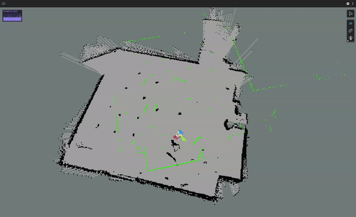
> Localizing the rover in my apartment

## **IMPORTANT NOTES**
* This folder should be placed in the same src folder as your completed hw2. You will need hw2 completed for the final part of this assignment.

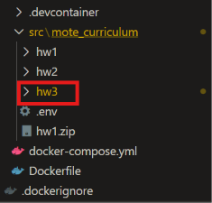

* From this assignment forward, you will be required to report if/how you used generative AI as per the course policy. This will be done in the writeup. **10% of your grade will be deducted** for failing to complete this section
* This homework will **require time in G23** to complete it (from Question 2 onward). **SIGN UP FOR A TIME** to access the arena. See the homework 3.2 release EdPost for more details.

## Foxglove Layout
* Apply the layout `mote_hw3_layout.json` in Foxglove in the same way you did in HW1/HW2.
* If you do not have the joystick, follow the instructions from the HW2 to add it

## Code Overview

You'll be writing code in the ROS package `hw3_pkg`. Specifically, you'll be implementing `particle_filter.py`. `particle_filter.py` is used by `pf_node.py` to produce a location estimate using your particle filter.

You'll be using the test files in `/test` to verify your implementation.

To run your completed algorithm, you'll use the launch file in `/launch/particle_filter.launch`. This launch file runs the following steps:

1. Includes `mote.launch` from `mote_base`. This brings up the drivers for communicating with the robot, and starts a node to produce odometry estimates ([see the source here](https://github.com/empriselab/mote-ros-noetic/blob/main/mote_base/launch/mote.launch)).
2. Runs the node `map_server` from the package `map_server`. This provides the map file (found in `hw3_pkg/maps`) as a ros topic. [Read more if you're curious](http://wiki.ros.org/map_server).
3. Includes `viz.launch` from `mote_viz`. This starts Foxglove bridge (how foxglove communicates with ROS. ([see the source here](https://github.com/empriselab/mote-ros-noetic/blob/main/mote_viz/launch/viz.launch)).
4. Runs your node, `particle_filter.py`. This starts your particle filter code.

You'll generate a recording of your ROS workspace using rosbag, ROS's tool for generating playback data.
You can read more about ROS bag files here: http://wiki.ros.org/Bags. They are an incredibly powerful tool for data collection and visibility.

Finally, you'll investigate how ROS allows you to use state of the art algorithms without having to implement them yourself.

## Q0. Gyroscope Tuning (10 pts)

The rover's Inertial Measurement Unit (IMU) contains an accelerometer (measuring linear acceleration) and a gyroscope (measuring angular velocity). 
All gyroscopes exhibit a small bias in their velocity readings. 
When the velocity is integrated to compute an orientation, this bias leads to a constant rotation known as gyroscope drift. 

We'll calibrate our gyroscope by simply subtracting out the bias term.

### **Q0.1**

Within hw3_pkg, open `launch/particle_filter.launch`. You should see three parameters: `gyro_bias_{x, y, z}`.

Before running the next package, we need to install a couple Python packages (numpy and scipy). To do this, run

```
$(rospack find hw3_pkg)/scripts/setup_env.sh
```
> **TIP**: Seeing `/bin/bash^M: bad interpreter: No such file or directory`? 
> <details> 
> <summary> Fix it by doing the following </summary>
> 
> Change the End of Line Sequence to CRLF to LF. To do this, open `setup.sh` in `src/mote_curriculum/hw3/hw3_pkg/scripts/setup_env.sh`.
> 
> In the bottom right hand corner of VSCode, you should see `CRLF` as the End of Line Sequence. Click on it to change it to `LF`.
> 
> 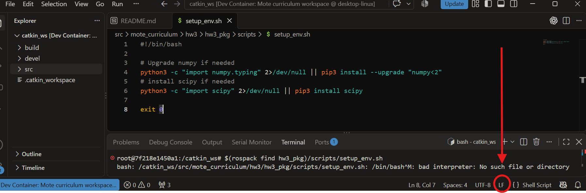
> 
> </details>

<br>

Sit your rover on a flat surface and don't touch it. Run 

```
roslaunch hw3_pkg particle_filter.launch
```

> **TIP**: Seeing `RLException: unused args [gyro_bias_x, gyro_bias_y, gyro_bias_z] for include of [/catkin_ws/src/mote_ros_noetic/mote_base/launch/mote.launch]`
> <details>
> <summary>Fix it by doing the following </summary>
> 
> With docker running, run `docker image ls`
> 
> Look for the image named `mote-ros-noetic`. Note the ID
>
> 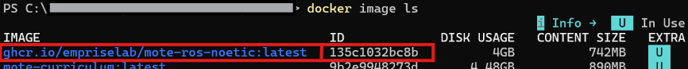
> 
> Run `docker rmi -f [ID]` 
>
> Then, Rebuild and Reopen the code in Dev Container!
> </details>


Open Foxglove and navigate to the IMU plot tab. In the gyroscope panel, you'll see readings for the x, y, and z angular velocities.

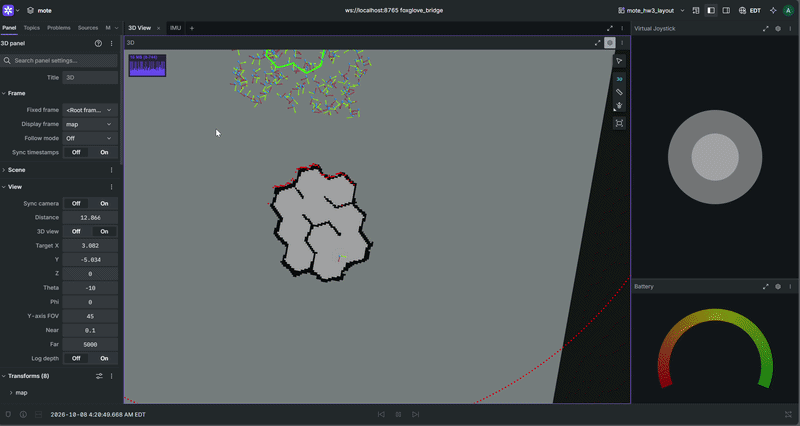

> 
> **Q0.1** - (5 pts): Take a screenshot of the uncalibrated IMU values at this point and include it in the writeup folder.

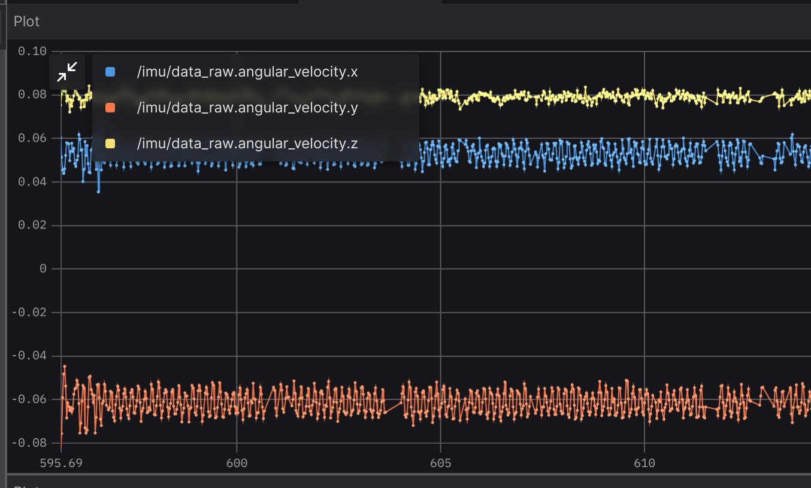
> Example biased gyro data, before tuning


> **TIP**: Double click the graph to reset the view.


<details>
<summary>Rubric (5 pts)</summary>

* **5 pts:** Picture of your untuned IMU graph from foxglove

</details>

### **Q0.2**


Note that each reading has a DC bias (constant offset from zero) + Gaussian noise.
Eyeball the bias for each axis and update the `gyro_bias_` terms in `particle_filter.launch`. This value will be subtracted from the respective axis.

Restart the `roslaunch` command from above. In the IMU panel the DC bias should have disappeared and all three readings should be centered on 0.
It's ok if the values are slightly off from zero, just try and get the center < +/-0.01 rad/s.

> **Q0.2** - (5 pts): Take a screenshot of your tuned IMU values at this point and include it in the writeup folder.

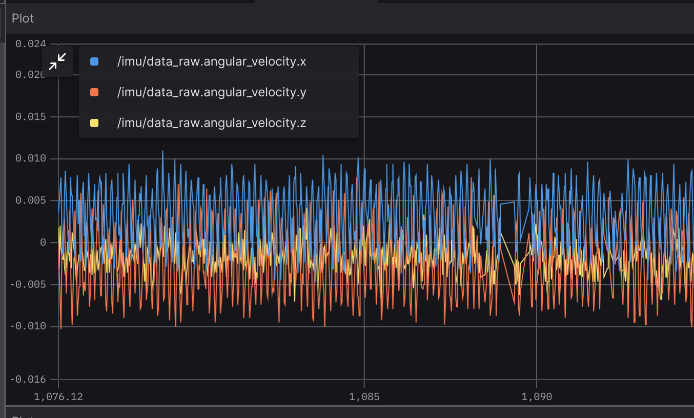
> Example unbiased IMU data, after tuning
<details>
<summary>Rubric (5 pts)</summary>

* **5 pts:** Picture of your tuned IMU graph from foxglove

</details>


## Q1. Creating a Sensor Model (50 pts)


Before you write any code, run 

```
roslaunch hw3_pkg particle_filter.launch
```
 
 and open Foxglove. You'll see the map, the particles (each represented by a frame), and two LiDAR scans (one red, one green).

 The red scan is the data the particle filter expects would result from its estimate. The green scan is the data that is actually coming from the robot. When the particle filter correctly converges, the two scans will overlap.

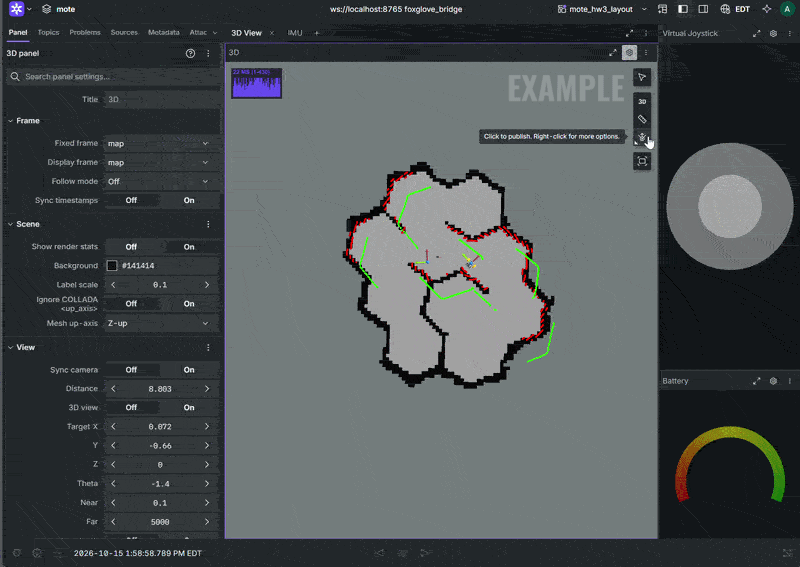
> Localization using a particle filter. Notice how the ground truth (green) and predicted (red) scans line up once the prediction converges.

Right now your filter will never converge. To get it to do so, you'll have to implement some missing functions.

Recall that a particle filter requires two components:

* A motion model, with which to update the particles between timesteps
* A sensor model, to report the likelihood that each particle is the correct pose

You'll implement the sensor model.

### **Q1.1**

The LiDAR will be modeled as follows:

1. Each scan contains 720 evenly spaced angular bins covering [0, 2π). The particle filter currently selects up to 60 measurements from each scan.
2. Each sample returns the distance from the center of the LiDAR to the nearest obstacle. If there is an error collecting a sample, it will return NaN or infinity.
3. Each measurement has additive Gaussian error.
4. All laser readings are independent and identically distributed (IID).

Point 4 allows us to compute the joint probability of each reading as the product of their individual probabilities.

In `hw3_pkg/particle_filter.py`, implement `sensor_model`. This will compute the probability of a reading `measurement` when the ground truth distances are `ground_truth`. 

Your implementation should pass the testcases `rostest hw3_pkg pf_tests.test` that start with test_sensor_model.


<details>
<summary>Rubric (15 pts)</summary>

* **15 pts:** pass the testcases `rostest hw3_pkg pf_tests.test` that start with test_sensor_model
</details>


### **Q1.2**

In `particle_filter.py`, implement `resample`. 

Your implementation should pass the testcases in `rostest hw3_pkg pf_tests.test`

<details>
<summary>Rubric (35 pts)</summary>

* **35 pts:** pass the rest of the testcases `rostest hw3_pkg pf_tests.test` 
</details>

## Q2. Particle Filter Localization in a Provided Map (30 pts)

From this point onward, you'll need to be in Gates G23 to test your algorithms.

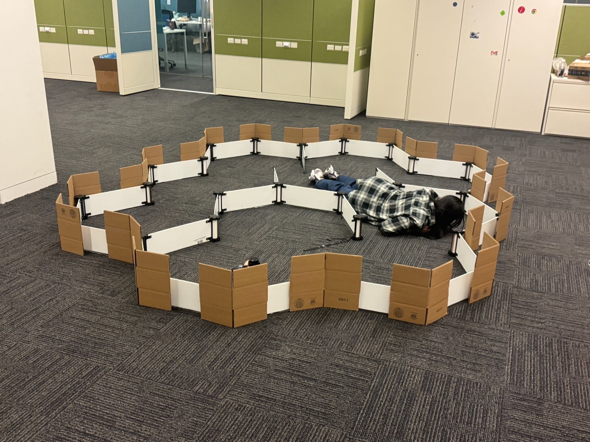 

> The arena setup in Gates G23 

### **Q2.1**

Time to test your implementation on the real robot. 

**Note: *PLEASE BE CAREFUL TO NOT DISRUPT THE MAP***. The position of the wall is marked with black tape. If walls are knocked down or moved, try to fix it or ask a TA to assist.

1. Place your robot in the arena

2. Run your node using the launch file

```
roslaunch hw3_pkg particle_filter.launch
```

3. Open Foxglove. You should see a map, the rover, and frames scattered around the map. Each frame corresponds to a particle in the particle filter.
The particles should start distributed over the map. They'll need some help to guess the robot's initial position. 

4. Find the "Publish pose estimate" button in the top right of the Foxglove 3D panel. If it says "Publish pose" or "Publish point", click and hold to open the options menu.

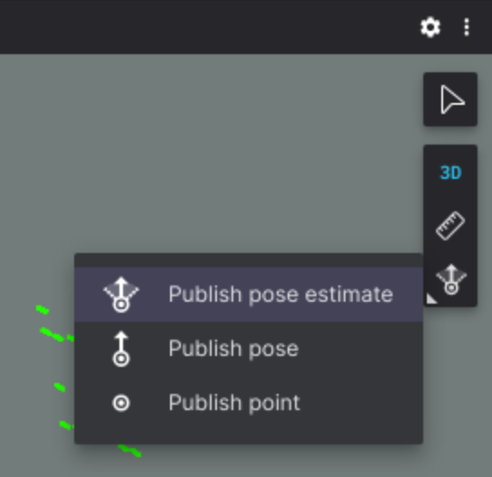

5. In the settings for the 3D view, set the display frame to "map". Click once to set the pose position, then move the mouse and click again to set the orientation.

> [**WARNING**]
> Make sure your display frame is set to map before you set your pose estimate. Otherwise, the pose will be published in the wrong coordinate frame.

6. Try localizing at different locations. Do some locations have better performance than others?

7. Drive around. How well does localization work when moving around?

> <details>
> <summary> Particles spreading out too much when you're driving? </summary>
> 
> You can reduce the noise terms in the `predict` function definition in `particle_filter.py`. Adjust the alphas, trans_jitter, or rot_jitter. The default is as follows in case you want to reset it:
> 
> `predict(self, prev_odom, curr_odom, alpha=(0.5, 0.5, 0.5, 0.5), trans_jitter=0.011, rot_jitter=0.051)`
>
>| Term | Meaning |
>|---|---|
>| **`a1`** | Rotation error caused by turning. Larger turns produce more uncertainty in rotation. |
> | **`a2`** | Rotation error caused by traveling. Moving farther produces more uncertainty in heading. |
> | **`a3`** | Distance error caused by traveling. Moving farther produces more uncertainty in distance. |
> | **`a4`** | Distance error caused by turning. Larger turns produce more uncertainty in translation. |
> | **`trans_jitter`** | minimum standard deviation of translation noise |
> | **`rot_jitter`** | minimum standard deviation for each rotation noise sample, in radians |
> </details>

</br>

> **Q2.1** - (15 pts) Record your particle filter localizing when given a **correct starting position**. Record your particle filter localizing when given a slightly **wrong starting position**. Record your particle filter when **driving** around the map. *Include your recordings in the writeup folder as* **good_start.[extension], bad_start.[extension], and driving_around.[extension]**


<details>
<summary>Rubric (15 pts)</summary>

* **5 pts:** good_start exists and converges on a good pose estimation
* **5 pts:** bad_start exists and converges on a reasonable pose estimation
* **5 pts:** driving_around exists and shows converging localization when driving around
</details>


### **Q2.2** 

Now that you've confirmed your implementation works, let's record a bag file for submission.

rosbag is a tool that records all ROS messages and allows you to replay them later. If you're curious, you can read more here: https://wiki.ros.org/rosbag

Here's the command to record your bag:

```
rosbag record -O /catkin_ws/src/mote_curriculum/hw3/bags/pf_test.bag --duration=30 -a
```

* rosbag is the executable we call
* record tells rosbag to start a recording
* -O specifies the output filepath
* --duration=30 limits the recording to 30 seconds
* -a records all topics

After you execute this command, repeat steps 1-5 to localize your robot in the map. The bag will automatically finish recording after 30 seconds.

We can confirm that your recording worked correctly by opening it in Foxglove.
In the top left corner of Foxglove, click the Foxglove logo and then "Open local file(s)". Navigate to your bag file, which is in `hw3/bags`. If everything went well, you can now playback your robot's localization!

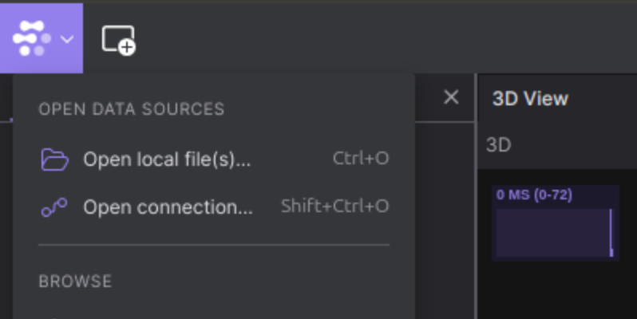
> The Foxglove local file button

> **Q2.2** (15 pts): Include the recorded rosbag in your submission. It should be in the folder `hw3/bags`.

<details>
<summary>Rubric (15 pts)</summary>

* **15 pts:** Include the recorded rosbag in your submission
</details>


## Q3. AMCL Localization (30 pts)

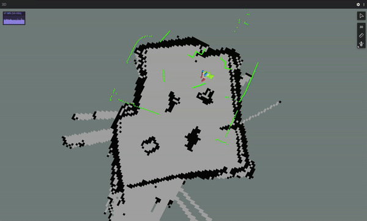
> AMCL localization and driving around

ROS is designed to abstract away the connection between hardware and software implementation.
Using ROS, we have access to the same algorithms that power robots like [Boston Dynamics' SPOT](https://github.com/bdaiinstitute/spot_ros2) or run [self driving cars that are on the road today](https://autoware.org/).

In this section, we will recreate everything you did in this assignment with just a few lines of code.

### **Q3.1**

Open [amcl.launch](https://github.com/empriselab/mote-ros-noetic/blob/main/mote_navigation/launch/amcl.launch). Let's break down what's going on here.

1. `mote-navigation` is a ROS package, a collection of related code and configuration files. This package contains launch files and configuration files for navigation related tasks for your rover.
2. The `launch` folder contains [ROS launch files](http://wiki.ros.org/roslaunch). These files list a collection of nodes and their parameters to run at the same time.
3. `amcl.launch` starts the `amcl` node from the `amcl` package. AMCL is an abbreviation for Adaptive Monte Carlo Localization, a particle filter base approach for localization on a known map. The launch file also includes many parameters for tuning the localization. You can read more if you're curious: http://wiki.ros.org/amcl

> <details>
> <summary> How does AMCL differ from the particle filter we implemented? </summary>
> 
> Like the our particle filter, it moves these particle using odometry, scores them against LiDAR measurements, and resamples to favor better matches. The main difference is that the our implementation keeps a fixed number of particles (300 by default), while AMCL automatically adjusts the number based on uncertainty—generally using more when the robot’s location is unclear and fewer when confident, saving computation. AMCL also supports adding random particles to help recover from an incorrect location estimate.
>
> </details>

Now open [amcl_localization.launch](https://github.com/empriselab/mote-ros-noetic/blob/main/mote_demos/launch/amcl_localization.launch). 
This launch file combines `amcl.launch`, `base.launch`, and other nodes to setup the full localization pipeline. 

Let's run the launch file and see what happens:

With all other nodes stopped, run

```
roslaunch mote_demos amcl_localization.launch map_file:=$(rospack find hw3_pkg)/maps/mote_arena.yaml
```

Return to Foxglove. Like with your particle filter, AMCL probably failed to localize without an initial prediction of the robot's location. Provide it using the "Publish pose estimate" button.

> **WARNING:**
> Make sure your display frame is set to *map* and *fixed frame* is set to ***Root Frame*** before you set your pose estimate. 
> Otherwise, the pose will be published in the wrong coordinate frame, and AMCL will ignore it.

Once the localization converges, drive your rover around the arena. Watch the robot's position with respect to the map.

How does the performance of AMCL compare with your particle filter?

> **Q3.1**
Record a rosbag of AMCL localization tracking your rover around the map. 

**BE CAREFUL TO CHANGE THE NAME OF THE ROSBAG OUTPUT FILE**. Otherwise rosbag will overwrite your last rosbag. Use the command:

```
rosbag record -O /catkin_ws/src/mote_curriculum/hw3/bags/amcl_test.bag --duration=30 -a
```

<details>
<summary>Rubric (15 pts)</summary>

* **15 pts**: Include the recorded rosbag in your submission. It should be in the folder `hw3/bags`.
</details>

### **Q3.2**

> **NOTE**: You must have homework 2 complete for the next section to work

In HW2, you made an odometry model to estimate the position of the robot as you drove around. 

> <details>
> <summary>What was odometry again?</summary>
>
> Odometry is the use of data from motion sensors to estimate change in position over time. In homework 2, you derived and implemented a motion model. 
> We use the readings from our motor encoders with our kinematic equations to estimate the position of the rover. 

</br>

Run this model by doing the following:

```
roslaunch hw3_pkg odometry.launch x:=0.0 y:=0.0 yaw:=0.0
```

Make sure your Fixed Frame and Display Frame are set to *map*. 

**Adjust the x, y, and yaw** to match your robot's initial position and facing (note: yaw is in radians). You can use the measure distance tool to help as shown below:

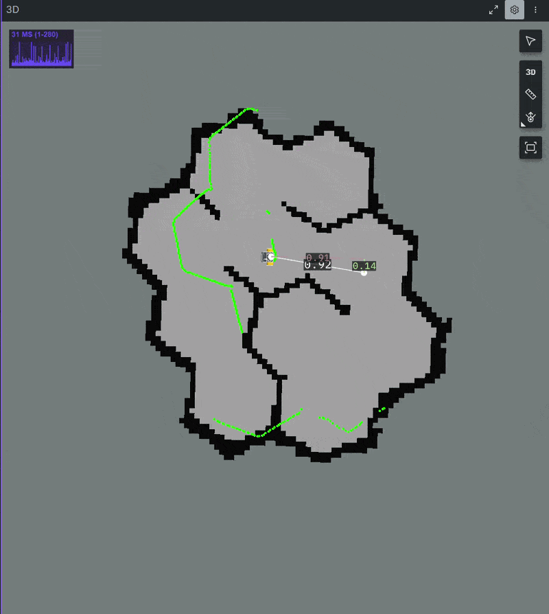

Drive a similar path with the odometry and the AMCL particle filter. Note the differences in performance between the odometry  and particle filter. 

> **Q3.2** How did the odometry only localization compare to the particle filter? Why would we expect the particle filter to perform better? Answer these questions in writeup.md

<details>
<summary>Rubric (15 pts)</summary>

* **5 pts:** States observations on running odometry vs particle filter
* **10 pts:** Explains why the particle filter should perform better than odometry
</details>

## Deliverables

1. **(10 pts)** Q0. Include your IMU graphs (tuned and untuned) in [Q0](./writeup/writeup.md) of `writeup.md`
2. **(15 pts)** Q1.1 Implement `sensor_model` in `particle_filter.py` passing the testcases `pf_tests.test` that start with test_sensor_model
3. **(35 pts)** Q1.2 Completed `resample` in `particle_filter.py` passing `pf_tests.test`
4. **(15 pts)** Q2.1 Include good_start, bad_start, and driving_around videos in `writeup` folder
5. **(15 pts)** Q2.2 Include rosbag `pf_test.bag` in `bags` folder
6. **(15 pts)** Q3.1 Include rosbag `amcl_test.bag` in `bags` folder
7. **(15 pts)** Q3.2 Answer Odometry vs Particle filter experiment [question](./writeup/writeup.md) in `writeup.md`
8. **(-12/0 pts)** Answer AI usage question
9. **(0 pts)** Completed `writeup/writeup.md` time spent and feedback.

## Submission

Submit one ZIP file containing the complete `hw3` folder to Gradescope. The `hw3` folder must be the wrapper folder in the ZIP; do not submit only its contents.

From the directory containing `hw3`, create the submission with:

```bash
cd /catkin_ws/src/mote_curriculum
zip -r hw3.zip hw3/
```

Before submitting, inspect the archive and confirm that it begins with the `hw3/` directory:

```bash
unzip -l hw3.zip
```

Submit once per group, and add your group members to the submission on Gradescope so everyone receives the grade.

Good job!                ヾ( ˃ᴗ˂ )◞ Bye