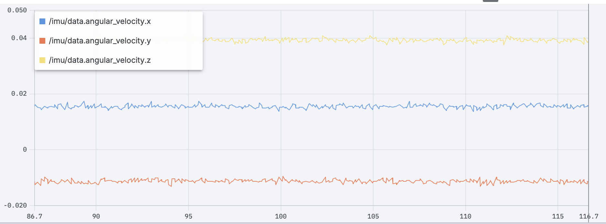
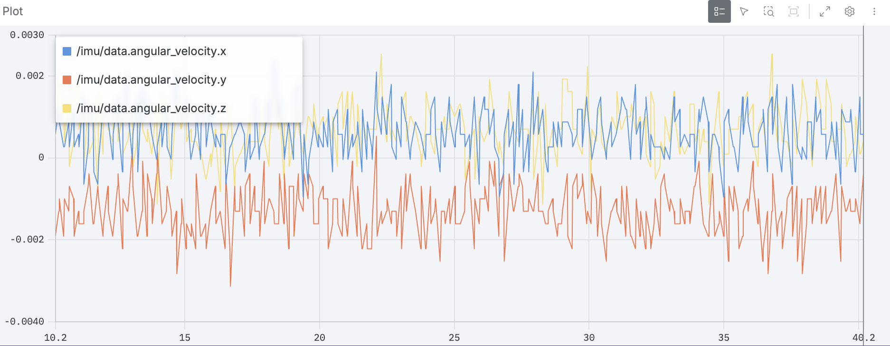
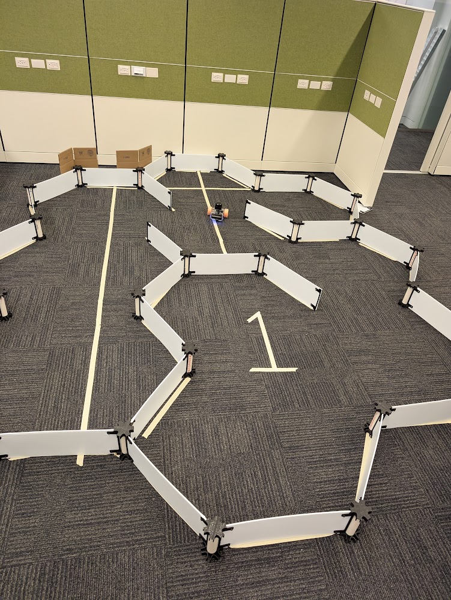

<!---
If you're new to markdown, check out this reference: https://www.markdownguide.org/basic-syntax/
-->

# Writeup

## Q0. Gyroscope Tuning (10 pts)

Untuned gyro:

Tuned gyro:

## Q2.1
<!-- Don't worry if these videos don't render. This is here as a reminder for you to include the videos at the correct file path!! -->
<video width="640" height="360" controls>
  <source src="./good_start.mp4" type="video/mp4">
  Your browser does not support the video tag.
</video>
<video width="640" height="360" controls>
  <source src="./bad_start.mp4" type="video/mp4">
  Your browser does not support the video tag.
</video>
<video width="640" height="360" controls>
  <source src="./driving_around.mp4" type="video/mp4">
  Your browser does not support the video tag.
</video>

## Q3.2

**How did the odometry only localization compare to the particle filter? Why would we expect the particle filter to perform better?**

The odometry only performed much worse. It overestimated distance and was particularly unreliable on turns. In the images attached, the error accumulation reached a point where the odometry thought the robot was multiple hexagons away from the actual location. The Lidar scans whilst using the particle filter had good agreement with the wall locations and thus when comparing the state estimation to reality, the particle filter performed much better. The odometry only locatization is only using the encoders and is suspectible to wheel slippage, these errors stack on top of each other causing larger position error over time/distance.

We expect the particle filter to perform better for a few reasons. One because it's combining the Lidar with the known map. Using particles for state estimation and then applying the motion model to each one allows for higher weighting of the particles who's predicted scan that match the actual scan. And secondly but related because error doesn't stack in the same way. This is because there's a consideration of uncertainty built into the localization. Just like in class when we saw the particles grow in length on a long corridor (because multiple particles produce similar scans, so the robot could be in lots of places, not just where the encoder thinks it is), it's applying kinematics to each of the particles and so accordingly it's able to readjust itself according to the environmental features instead of assuming that the encoder is correct. In other words, it's able to adjust and update itself based on the new information from the Lidar sensor interacting with the environment, instead of automatically believing that it's encoders are correct. 

Picture of actual location

Screenshot of odometry only location

Screenshot of moving uncertainty of particle filter

Screenshot of particle filter location

## AI usage (-12 pts if incomplete)
**Did you use AI for this assignment? If so, how was it used? Eiher state "no AI was used" or explain *how* it was used. Failure to complete this section will result in 10% of your grade being lost**

* Used AI (GPT-6) to clean up Q1.1 code (specifically, implement np.prod rather than coding the product)

* Used Ai (GPT-6) to debug modifying the arrays in place

## Feedback

**How much time did you spend on this assignment?** 
Q0-1: 2h (had some trouble connecting to the robot, otherwise 1h)
Q2: 0.5h
Q3: 1.5h

**Do you have any feedback for this assignment?**

N/A
