# HW 4: Planning

## Summary

In this assignment, you will:

1. Implement a path planner using A* and RRT for a 2D world.
2. Apply the path planners to generate a valid path for your robot car.

## Section 0: Before You Start (5 points)
Due to issues with the battery weight, some students have reported that their battery port has fallen off.

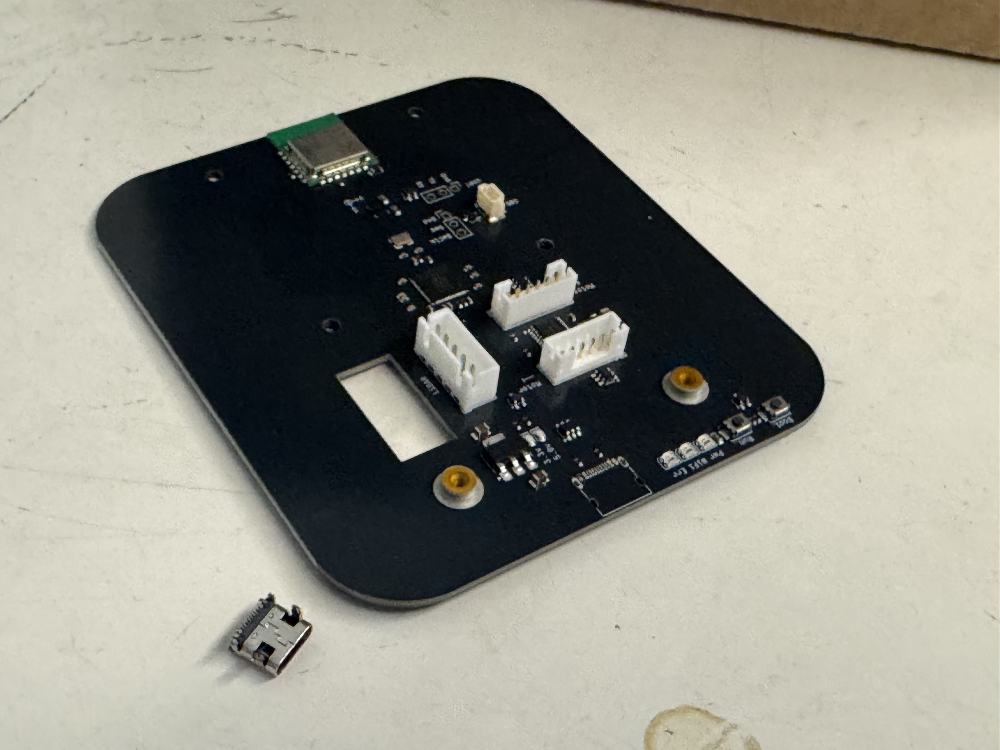

To prevent this, please make sure to grab a battery mounting bracket from the lab to support the weight of the battery. If you have any questions, please reach out to the TAs. They can be located in the corner of the lab.

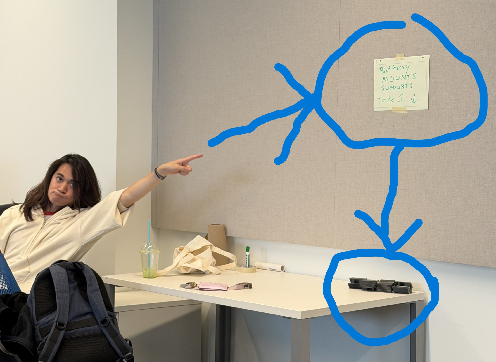

To install it, unscrew your tail runner, then place the battery mount under the tail runner and screw it back in. Here are the locations of the screws and what the assembled part should look like:

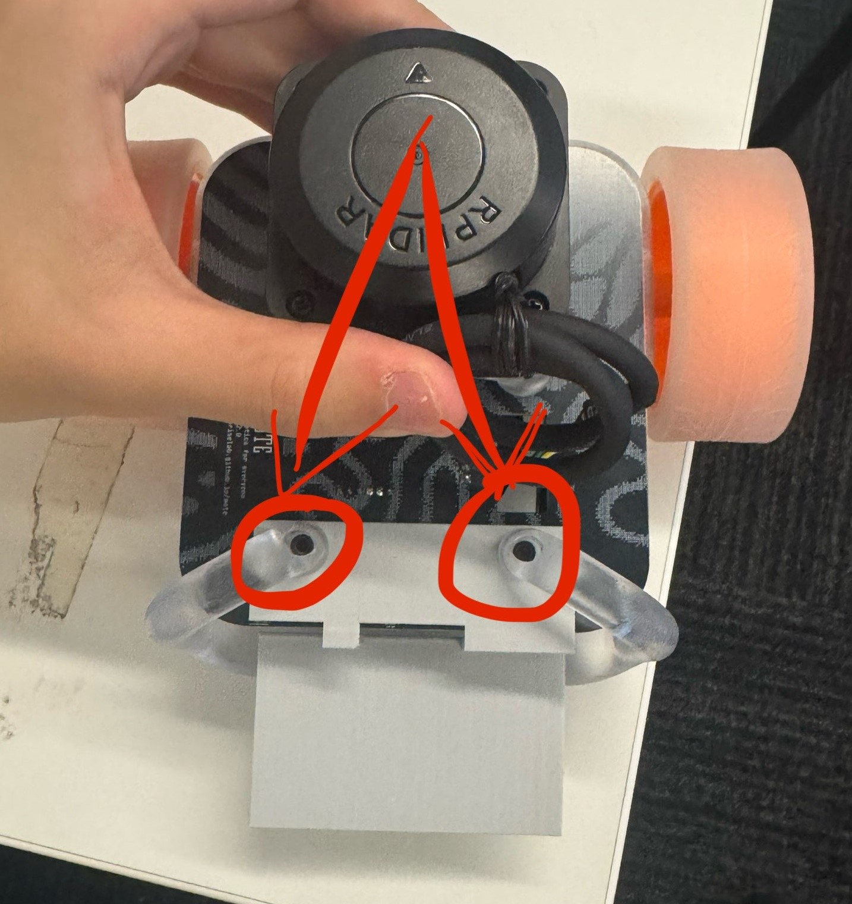
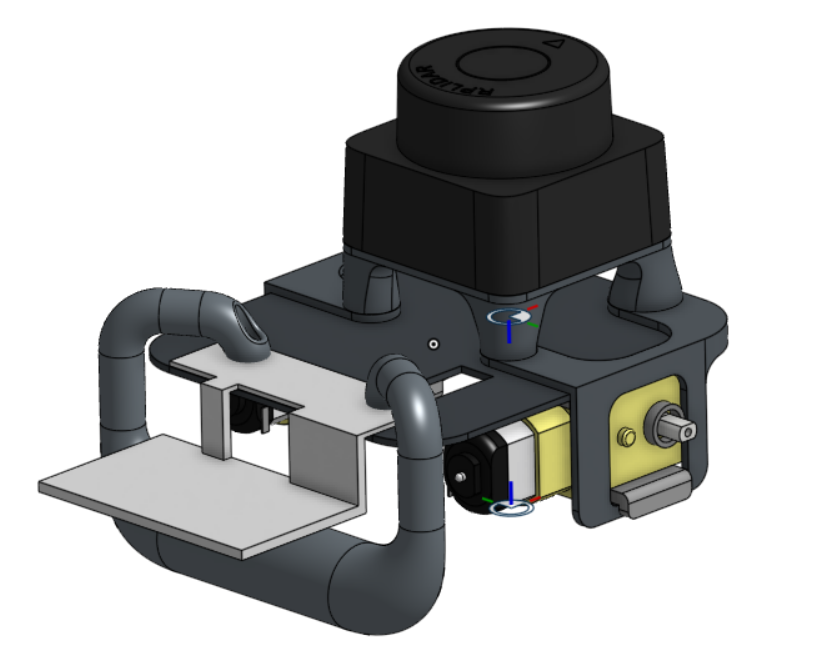

**Q0:** Submit a picture of your battery mounting bracket installed in the writeup folder.

<details>
<summary>Rubric (5 pts)</summary>

* **5 pts:** Includes picture of battery mounting bracket installed on the car in the writeup.

</details>

## Section 1: A* and RRT (60 points)

### Code Overview
The first step of motion planning is to define the problem space (`planning/src/planning/problems.py`). This section only considers `PlanarProblems`: `R2Problem`. The `R2Problem` configuration space only considers the x- and y- positions. The `PlanarProblem` class implements shared functionality, such as collision-checking. The specific problems implement their own distance and steering functions to connect two configurations. After defining these classes, the rest of your planning algorithm can abstract away these particulars of the configuration space. (To solve a new type of problem, just implement a corresponding problem class.)

The Roadmap class contains many useful methods and fields. Three fields are particularly important: `graph`, `vertices`, and `weighted_edges`. `Roadmap.graph` is a [NetworkX](https://networkx.org/) graph, either `undirected` or `directed` depending on the problem type. The starter code already handles interacting with this object. Nodes in the NetworkX graph have integer labels. These are indices into `Roadmap.vertices`, a NumPy array of configurations corresponding to each node in the graph. `Roadmap.weighted_edges` is a NumPy array of edges and edge weights; each row `(u, v, w)` describes an edge where `u` and `v` are the same integer-labeled nodes and `w` is the weight (length for R2) of the edge between them.

### Q1. Searching on R2 Problems using A* (20 points)
In this problem, we will write the A* planning algorithm for a roadmap. Roadmaps are already provided - to visualize a simple roadmap, run the following command:

```
roscd planning
python3 scripts/roadmap --saveto "test/share/map1.pkl" --netids a,b,c -m test/share/map1.txt --show-edges --save-image writeup/roadmap.png
```

<figure>
  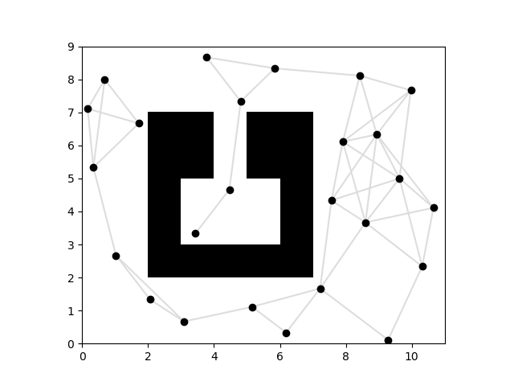
 <figcaption> Figure 1: A simple roadmap </figcaption>
</figure> 
<br/><br/>

The A* algorithm expands nodes in order of their f-value $f(n) = g(n) + h(n)$, where $g(n)$ is the estimated cost-to-come to the node $n$ and $h(n)$ is the estimated cost-to-go from the node $n$ to the goal. For this problem, we will use the Euclidean distance for both cost-to-come and cost-to-go.

**Q1.1** Implement the `compute_distance` function for `R2Problem` class in [`planning/src/planning/problems.py`](planning/src/planning/problems.py). Your implementation should compute the Euclidean distance between corresponding elements of two arrays of states in R2 space. Note that `cost_to_go` makes use of `compute_distance` to compute the heuristic cost.

You can verify your implementation on the provided test suites by running `python3 test/problems.py`. 

> **Common Problems:**
> <details>
> <summary>"AttributeError: module 'numpy' has no attribute 'int'"</summary>
>
> If this error appears while importing NetworkX after installing the HW3 dependencies, your container has NetworkX 2.4, which is incompatible with NumPy 1.24. NetworkX 2.4 (the default version of NetworkX) uses `np.int` which was removed in later versions of Numpy. Run the following command in the same container, then retry your test or planner command:
>
> ```bash
> python3 -m pip install "networkx==2.8.8"
> ```
>
> This version works with both the original NumPy 1.17 and the NumPy 1.24 used for HW3.
> </details>

<details>
<summary>Rubric</summary>

5 points for passing test suites in `test/problems.py`
</details>

**Q1.2:** Implement the main A* logic in [`planning/src/planning/search.py`](planning/src/planning/search.py). For each neighbor, check if it hasn't been expanded yet, and if so, compute the cost-to-come of the neighbor node via the current node (cost-to-come for the current node, plus the length of the edge to the neighbor). Next, compute the f-value of the neighbor node (cost-to-come plus heuristic). Insert a `QueueEntry` with this information into the [priority queue](https://en.wikipedia.org/wiki/Priority_queue) (You can learn more about our provided priority queue in `search.py` line 15-24). Then, implement `extract_path` to follow the parent pointers from the goal to the start; this function is called by A* after the goal has been expanded to finally return the sequence of nodes.

You can verify your implementation on the provided test suites by running `python3 test/astar.py`. This file contains tests for both `R2Problem` and `SE2Problem` (which we will implement in the next section). Make sure your implementation is passing the `test_astar_r2problem` suites (it is fine to be failing `test_astar_se2problem` suites right now).

You should now be able to run an A* planner from the start to the goal! The following command specifies that it is an `R2Problem`, planning from the start of (1, 6) to the goal of (9, 3). Your plot should match the reference plot below. Make sure to add your netids to the command below.

```
python3 scripts/run_astar --netids a,b,c -m test/share/map1.txt -n 25 -r 3.0 --show-edges --save-image writeup/astar_map1.png r2 -s 1 6 -g 9 3
```

<figure>
  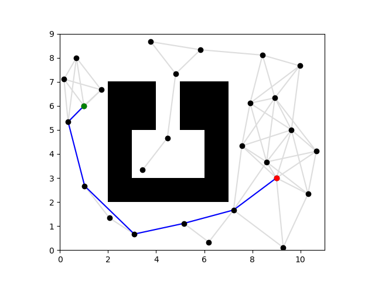
  <figcaption> Figure 2: A* path in blue on map1.txt, from (1, 6) in green to (9, 3) in red. </figcaption>
</figure> 
<br/><br/>

Compute the shortest path on map2.txt between (252, 115) and (350, 350) with the following command: 

```
python3 scripts/run_astar --netids abc123 -m test/share/map2.txt -n 600 -r 100 --save-image writeup/astar.png r2 -s 252 115 -g 350 350
```

Include the shortest path figure in your submission in `planning/writeup/`. Make sure to add your netids to the command above.

> **Common Problems:**
> 
> **Can't Save Figure in Docker?**
>
> 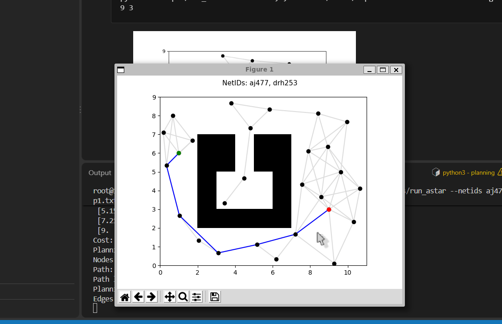
> <br>
>
> **Pop-up window doesn't show up?**
>
> Make sure you closed the window from the previous run. You can close the window by clicking the X in the top right corner of the window or with CTRL+C.
> 
> The popup may also not appear on Mac/Linux computers. The image will be saved as per the path in the `--save-image` argument, where you can check it out.

<details>
<summary>Rubric</summary>

10 points for passing `test_astar_r2problem` suites in `test/astar.py` <br>
5 points for correct shortest path figure corresponding to problem on map2.txt with your netids
</details>

### Q2. Searching on R2 Problems using RRT (25 points)

You will be implementing a Rapidly-Exploring Random Tree (RRT) for the same 2D world. For more details on the algorithm, refer to the reading material on the course website. The main algorithms are to be implemented in `RRTPlanner` class in [`planning/src/planning/search.py`](planning/src/planning/search.py). A class called `RRTTree` is implemented in [`planning/src/planning/RRTTree.py`](planning/src/planning/RRTTree.py).

**Q2.1** Implement the main RRT logic in [`planning/src/planning/search.py`](planning/src/planning/search.py).  First, implement the `extend` function in class `RRTPlanner`. Then, complete the `Plan` function. Specifically, you will need to sample a random point and add vertex/edge accordingly.  

You should now be able to run a RRT planner from the start to the goal! The following command specifies that it is an R2Problem, planning from the start of (1, 6) to the goal of (9, 3). Your plot should match the reference plot below.

```
roscd planning
python3 scripts/run_rrt --netids a,b,c -m test/share/map1.txt -s 1 6 -g 9 3 --show-tree --save-image writeup/rrt_map1.png --save-gif writeup/rrt_map1.gif
```
> The `--show-tree` flag allows you to visualize the growing of your tree in real time. You can also specify how many random samples you want to draw at each iteration by specifying `-size n`, where n is the number of samples. You can also specify step size eta using the flag `-e`. The `--save-gif` flag allows you to save the tree growth as a gif and see the growing in real-time if the pop-up window doesn't show up.

 <figure>
  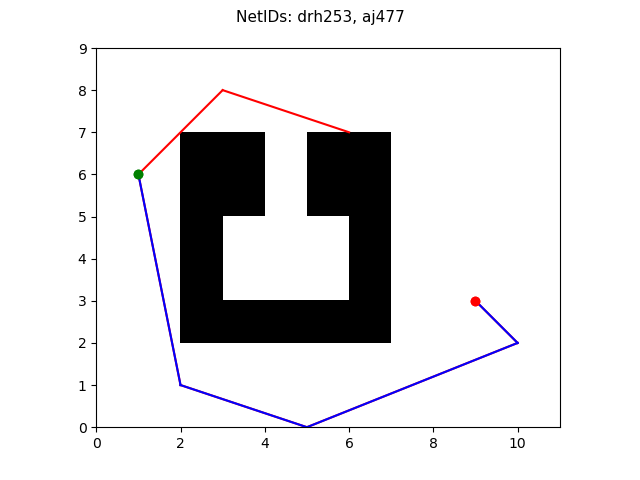
  <figcaption>Figure 3: RRT path in blue on map1.txt, from (1, 6) in green to (9, 3) in red.</figcaption>
</figure> 
<br/><br/>

Your implementation is expected to pass `python3 test/rrt.py`. 

Run RRT on map2.txt to find the path between (252, 115) and (350, 250) with the following command: 

```
python3 scripts/run_rrt --netids abc123 -m test/share/map2.txt -s 252 115 -g 350 250 --show-tree -size 100 --save-image writeup/rrt.png --save-gif writeup/rrt.gif
```

Include the figure visualizing the RRT path in your submission in `planning/writeup/`. Again, make sure to add your netids to the command above.

<details>
<summary>Rubric</summary>

10 points for passing test suites in `test/rrt.py` <br>
5 points for correct RRT path figure corresponding to problem on map2.txt with your netids
</details>

**Q2.2** RRT planner's output is usually not optimal, and some postprocessing is required. Implement the `ShortenPath()` function in [`planning/src/planning/search.py`](planning/src/planning/search.py). 

Once you finish, add flag `--shortcut` to visualize new plan. Shortcuts will be shown in color green.

```
python3 scripts/run_rrt --netids a,b,c -m test/share/map1.txt -s 1 6 -g 9 3 --show-tree --shortcut --save-image writeup/rrt_shortcut.png --save-gif writeup/rrt_shortcut.gif
```
Your plot should match the reference plot below.

 <figure>
  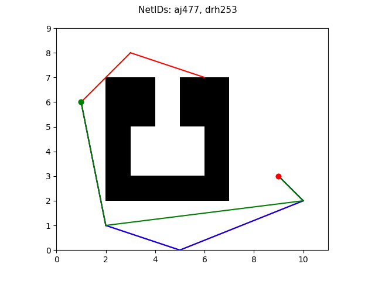
  <figcaption>Figure 4: RRT path in blue on map1.txt, shortcut in green from (1, 6) in green to (9, 3) in red.</figcaption>
</figure> 
<br/><br/>

Your implementation is expected to pass `python3 test/rrt_shortcut.py`. 

<details>
<summary>Rubric</summary>

10 points for passing test suites in `test/rrt_shortcut.py`. <br>
</details>

### Q3. Tradeoffs between A* and RRT (15 points)
Now that you have implemented A* and RRT, you will explore their tradeoffs. You will be constructing maps where A* prevails over RRT and where RRT prevails over A*. Under `test/share` are two text files that you will be modifying for this question, `astar_beats_rrt_map.txt` and `rrt_beats_astar_map.txt`. 

Each file is currently a 20 by 20 grid of 1s, representing open space. By changing a 1 to a 0, you can create a wall in the map. The coordinate system of the grid is at the upper left corner such that the x-axis increases to the right and the y-axis increases downwards. 

To manually test a map using A*, use

```
python3 scripts/run_astar --netids a,b,c -m test/share/<map_name>.txt -n 100 -r 3.0 --sampler lattice --save-image writeup/astar_beats_rrt.png r2 -s 1 1 -g 19 19
```

and verify your plot matches the reference plot below when using an empty map.
<figure>
  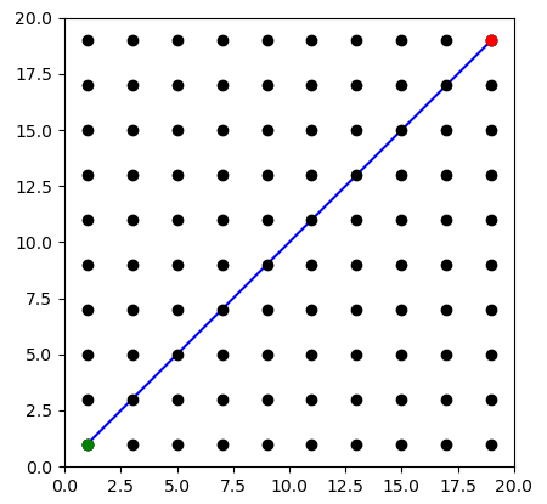
  <figcaption>Figure 5: A* path in blue from (1, 1) in green to (19, 19) in red.</figcaption>
</figure> 
<br/><br/>

To manually test a map using RRT, use

```
python3 scripts/run_rrt --netids a,b,c -m test/share/<map_name>.txt -s 1 1 -g 19 19 -size 100 --save-image writeup/rrt_beats_astar.png --save-gif writeup/rrt_beats_astar.gif
```

and on an empty map, verify your plot matches the reference plot below.

<figure>
  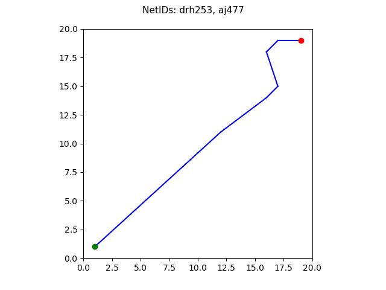
  <figcaption>Figure 6: RRT path in blue, from (1, 1) in green to (19, 19) in red.</figcaption>
</figure> 
<br/><br/>

When you are done, run the `python3 test/tradeoff.py` to test your maps.

The tests run RRT in a separate process with random seed 112 and a ten-second planning budget. For the A*-wins map, A* must find a path and RRT must return no path or exceed that budget. For the RRT-wins map, A* must find no roadmap path and RRT must return a valid path within the budget. Exceptions and invalid returned paths fail either test. Timing depends on the machine running the tests.

Include the path created by A* in the `astar_beats_rrt_map.txt` map and the path created by RRT in the `rrt_beats_astar_map.txt` map in your submission under `planning/writeup/`. Then explain the tradeoffs between A* and RRT under [`planning/writeup/writeup.md`](planning/writeup/writeup.md).

<details>
<summary>Hint</summary>

To make the paths more predictable for A*, this question uses a lattice sampler which constructs the roadmap as a lattice. Previous questions use a Halton sampler which has a better spread of roadmap points. Think about how you can use this detail to construct your maps.
</details>

<details>
<summary>Rubric</summary>

5 points for passing test suites in `test/tradeoff.py` <br>
5 points for reasonable A* and RRT paths <br>
5 points for correct explanation of tradeoffs
</details>


## Section 2: Planning for Car (15 points)

### Q4. Searching on SE(2) using AStar (15 points)

So far, we’ve been solving `R2Problems`. But since the Mote robots have an orientation, the problems we need to solve are `SE2Problems`, which concerns about both x, y position, and orientation. Thus, your NetworkX graph will have directed edges. The [Dubins path](https://en.wikipedia.org/wiki/Dubins_path) connects two configurations, with a maximum specified curvature<sup>[1](#1)</sup>. Since the Dubins path is directed, the graph will be directed. As a result, more vertices are generally needed for the graph to be connected.

Implement the `compute_distance` function for `SE2Problem` in [`planning/src/planning/problems.py`](planning/src/planning/problems.py) (remember to make use of `dubins.path_length()`). Your implementation should compute the cost estimate between two states in SE2 space. Note that `cost_to_go` uses `compute_distance` to compute the heuristic cost. 

You can verify your implementation on the provided test suites by running `python3 test/astar.py`. Your implementation should pass the `test_astar_se2problem` suites. 

To visualize planned path with Dubins path as edges, run
```
python3 scripts/run_astar --netids a,b,c -m test/share/map1.txt -n 40 -r 4 --show-edges --save-image writeup/astar_se2.png se2 -s 1 6 0 -g 9 3 45 -c 3
```
Your plot should match the reference plot below.

<figure>
  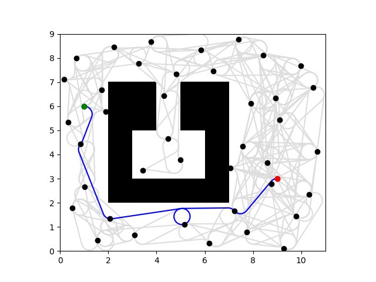
  <figcaption>Figure 7: AStar SE(2) path in blue on map1.txt, from (1, 6) in green to (9, 3) in red.</figcaption>
</figure> 
<br/>

**Q4.1:** Implement the `compute_distance` function for `SE2Problem`. Your implementation should pass the `test_astar_se2problem` suites in `test/astar.py`.

<details>
<summary>Rubric</summary>
5 points for passing `test_astar_se2problem` suites in `test/astar.py`
</details>
<br>

After you have successfully implemented the `compute_distance` function for `SE2Problem`, you should be able to use A* to plan the path for the car in the maze roadmap.

> The following command will take a couple minutes to run the first time, but will be faster on subsequent runs.

```
roslaunch planning astar_test.launch dubins:=true
```
><details>
> 
> <summary><strong>Note: Why does this take so long the first time?</strong></summary>
>
> Before you choose a goal, the A* demo builds a roadmap: a graph of collision-free graph that A* can search.
>
>It build this roadmap by:
>
>1. Placing samples throughout the configuration space, keeping those in free space. Each vertex is (x, y) for R2 (dubins:=false) or (x, y, heading) for SE(2) (dubins:=true).
>2. Finding possible connections. The planner considers connections whose path length is within connection_radius. R2 connections are straight segments; SE(2) connections are directed Dubins curves constrained by the car's turning radius.
>3. Checking for collisions. The planner samples each connecting path and checks it against the occupancy map. Only collision-free connections become graph edges. Checking many possible connections can take time.
>4. Searching when a goal arrives. The planner connects the current start and requested goal to the roadmap, runs A*, and displays the selected route in Foxglove.
> 
>On subsequent runs, the roadmap is already built and cached, so the planner can skip straight to searching when a new goal arrives.
>
>RRT does not build this roadmap. It grows a new tree from the start during each planning request, which you can watch in Foxglove.
> </details>
<br>

To visualize the planned path in Foxglove:
1. Run the above command to launch the ROS node.
2. Set your **fixed frame** to `map` in and your **display frame** to `map`.
3. Click on the **Publish 2D pose estimate (/initialpose)** button to select an initial pose (top-most option).
4. Click on the **Publish 2D pose (/move_base_simple/goal)** button to select a goal pose (middle option).

<figure>
  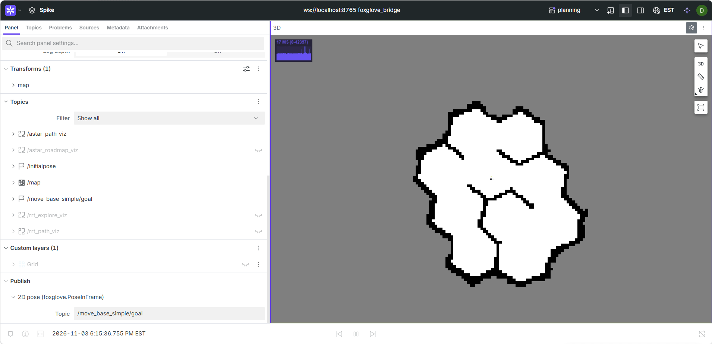
  <figcaption>Figure 8: Planned path in Foxglove.</figcaption>
</figure> 
<br/>

**Q4.2:** In your writeup, include a screenshot of an initial position and goal in Foxglove that **DOESN'T** have a valid A* path in SE(2). When you select a goal that is unreachable, the A* planner will output: ```[WARN] [1793750913.911528]: A* could not find a path: Node 1001 not reachable from 1000. Connection limit is 1.50 meters. Check pose headings and turning clearance in Dubins mode; a larger connection_radius or more vertices may help a disconnected roadmap.``` in the terminal. Include a short explanation of why the path is not valid in your writeup. 

<details>
  <summary>Rubric</summary>

  * 2.5 points for screenshot of an initial position and goal in Foxglove that **DOESN'T** have a valid A* path in SE(2)

  * 2.5 points for a short explanation of why the path is not valid
</details>
<br>

**Q4.3:** Rerun the command to visualize the same initial pose and goal pose in Foxglove using RRT via `rrt_test.launch`. Include a screenshot visually comparing them. You can enable multiple paths under the `Topics` tab in Foxglove.


> **Common Problems:**
> <details>
> <summary>"/usr/bin/env: ‘python3\r’: No such file or directory" </summary>
>
> As discussed in HW1, this is most likely because you are on a Windows machine.
> This is caused by Windows having different line endings compared to linux. When you create the docker container, the Windows line endings from your local computer carry over into the linux machine, causing the Python shebang to not get interpretted correctly. If you are using VS Code, you can switch the line endings by clicking the "CRLF" in the bottom right corner and then clicking "LF" in the new popup.
>
> 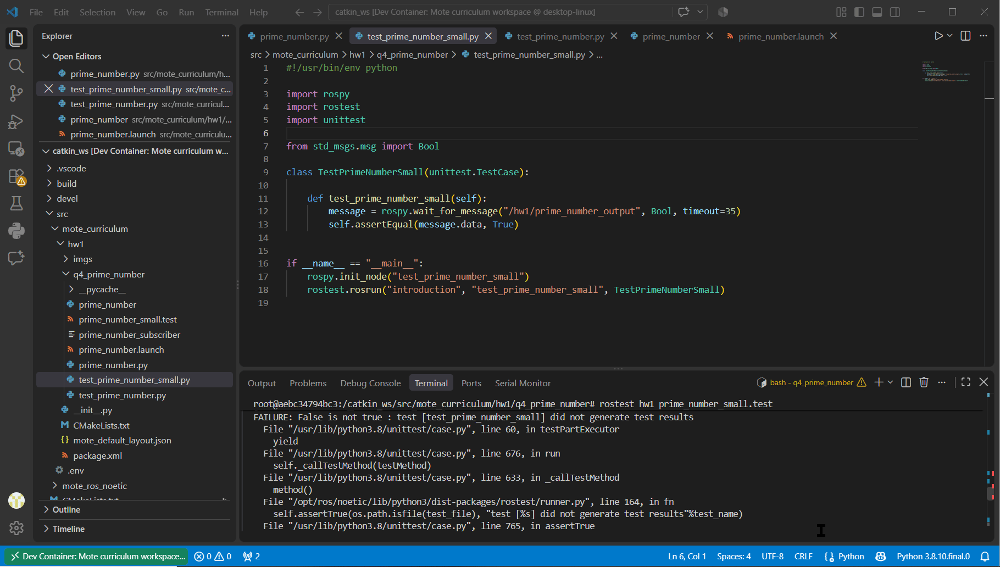
> 
> To run [`planning/launch/astar_test.launch`](./planning/launch/astar_test.launch) and [`planning/launch/rrt_test.launch`](./planning/launch/rrt_test.launch), you will need to change both of thee line endings of [`planning/scripts/astar_node.py`](./planning/scripts/astar_node.py) and [`planning/scripts/rrt_node.py`](./planning/scripts/rrt_node.py).
> </details>
> 
> <details>
> <summary>Can't visualize both the RRT and A* paths?</summary>
> 
> Make sure that both the eyes next to the topics `/rrt_path_viz` and `/astar_path_viz` are enabled in the `panel` tab in Foxglove. You can enable them by clicking on the eye icon next to the topic name. 
> 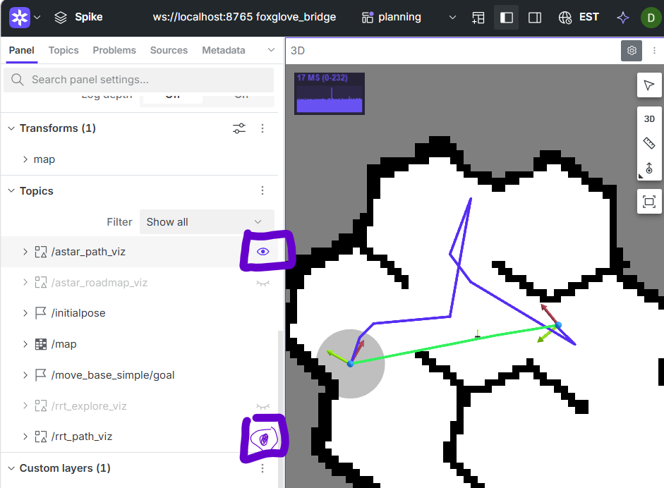
> </details>
<br>

<details>
<summary>Rubric</summary>

* 5 points for screenshot visually comparing the A* and RRT paths in Foxglove with the same initial pose and goal pose

 <br>
</details>

## Deliverables

Place all figures, screenshots, and written answers in [`planning/writeup/`](./planning/writeup/), and include them in [`planning/writeup/writeup.md`](./planning/writeup/writeup.md), labeled by question number. Include your NetIDs on the planner figures as requested above.

1. **(5 pts)** Q0: Picture of the battery mounting bracket installed on your car.
2. **(5 pts)** Q1.1: Completed `R2Problem.compute_distance` in `planning/src/planning/problems.py`, passing the R2 problem tests in `test/problems.py`.
3. **(10 pts)** Q1.2: Completed A* search and path extraction in `planning/src/planning/search.py`, passing the `test_astar_r2problem` suites in `test/astar.py`.
4. **(5 pts)** Q1.2: A* shortest-path figure on `map2.txt`, from (252, 115) to (350, 350), with your NetIDs.
5. **(10 pts)** Q2.1: Completed RRT `extend` and `Plan` methods, passing `test/rrt.py`.
6. **(5 pts)** Q2.1: RRT path figure on `map2.txt`, from (252, 115) to (350, 250), with your NetIDs.
7. **(10 pts)** Q2.2: Completed RRT `ShortenPath` method, passing `test/rrt_shortcut.py`.
8. **(5 pts)** Q3: Modified `planning/test/share/astar_beats_rrt_map.txt` and `planning/test/share/rrt_beats_astar_map.txt`, passing `test/tradeoff.py`.
9. **(5 pts)** Q3: Figures showing the A* path on `astar_beats_rrt_map.txt` and the RRT path on `rrt_beats_astar_map.txt`.
10. **(5 pts)** Q3: Written explanation of the tradeoffs between A* and RRT on your maps.
11. **(5 pts)** Q4.1: Completed `SE2Problem.compute_distance`, passing the `test_astar_se2problem` suites in `test/astar.py`.
12. **(5 pts)** Q4.2: Foxglove screenshot of an initial pose and goal with no valid A* path in SE(2), plus a short explanation (2.5 pts each).
13. **(5 pts)** Q4.3: Foxglove screenshot visually comparing A* and RRT using the same initial pose and goal pose.
14. **(-8/0 pts)** Answer AI usage question
15. **(0 pts)** Completed `writeup/writeup.md` time spent and feedback.

Test paths above are relative to the `planning/` directory.

## Submission

Submit one ZIP file containing the complete `hw4` folder to Gradescope. The `hw4` folder must be the wrapper folder in the ZIP; do not submit only its contents.

From the directory containing `hw4`, create the submission with:

```bash
cd /catkin_ws/src/mote_curriculum
zip -r hw4_planning.zip hw4/
```

Before submitting, inspect the archive and confirm that it begins with the `hw4/` directory:

```bash
unzip -l hw4_planning.zip
```

Confirm that the archive includes your completed planning code, both modified Q3 maps, and the complete `planning/writeup/` directory with its `README.md` and all deliverable images.

### Adding images to the writeup

Save all deliverable images in `hw4/planning/writeup/` and embed them in `planning/writeup/writeup.md` using relative links:

```markdown

```

Open `planning/writeup/writeup.md` before submitting and verify that all images render correctly and all written answers are included.

Submit once per group, and add your group members to the submission on Gradescope so everyone receives the grade.

bye ＼＼\\٩( 'ω' )و //／／