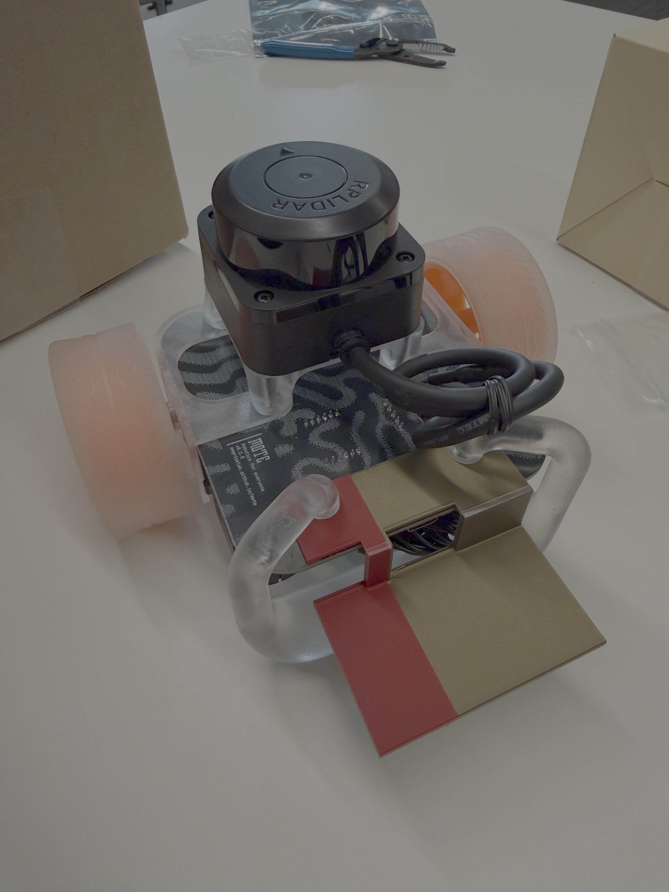
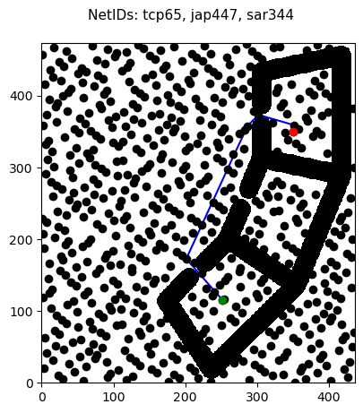
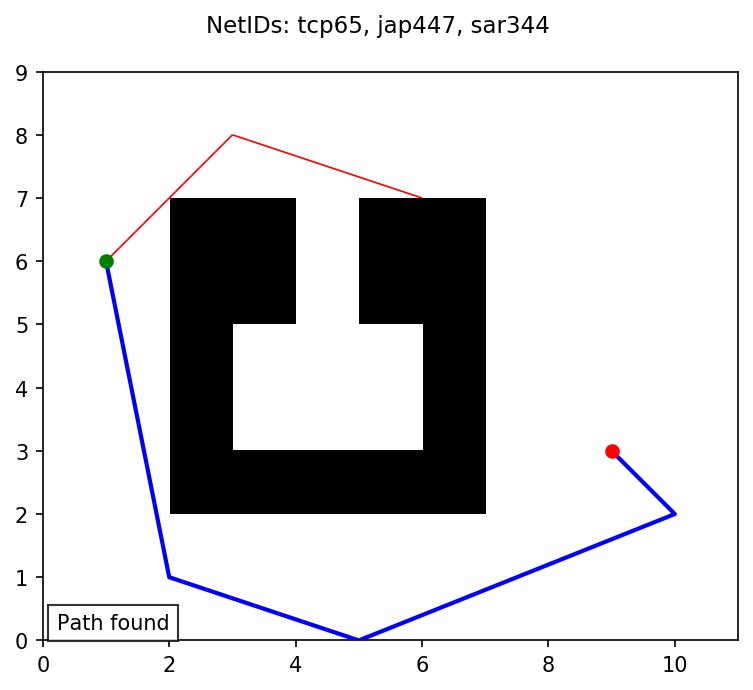
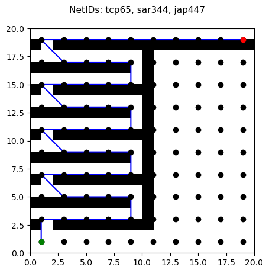
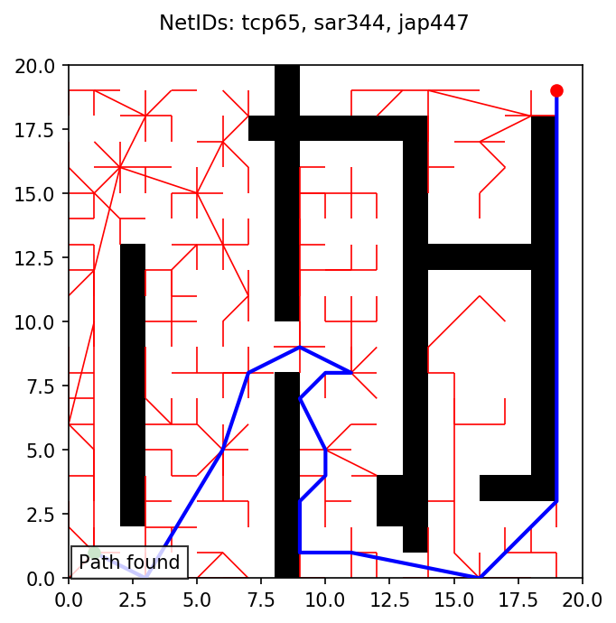
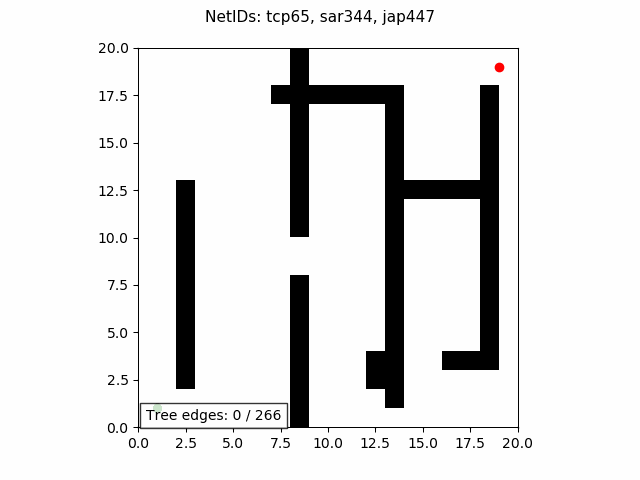

# Project 4: Planning 

Replace this with your own writeup! Please place all figures and answer all questions in this directory.

**Q0** Assembled battery mount:

**Q1.2** A* Shortest Path Figure: 

**Q2.1** RRT Path Figure: ...

**Q3**

A* beats RRT Figure:

A* is better than RRT because ...

RRT beats A* Figure:

RRT is better than A* because A* can only find paths that exist on its precomputed roadmap. A*'s roadmap has fixed sample spacing and connection radius, so gaps that do not fall within the vertices of its roadmap are not captured, making it impossible for A* to find a path from the starting point to the end point, even though it can use these gaps/openings. RRT, however, does not fall into this trap. It samples anywhere while it plans, so it only needs to get lucky once to find an opening that leads to a feasible path between the start and end points. The tradeoff is that RRT's path can be pretty bad (ours wanders a lot before reaching the end goal), and how long it takes depends on the random samples.
**Q4**

Q4.2

Q4.3

## AI usage (-8 pts if incomplete)
**Did you use AI for this assignment? If so, how was it used? Eiher state "no AI was used" or explain *how* it was used. Failure to complete this section will result in 10% of your grade being lost**

For Question 1.2, the context of available variables and the basic A* logic from class was provided to create the code snippets using GPT 6.2 Sol. 

For Question 2.1, the context of available variables and the RRT logic from class was provided to create the code snippets using GPT 6.2 Sol.

For Question 2.2, the context of the variables and the context of needing a shortcut algorithm that tries to connect nodes to shorten the path for postprocessing was provided to create the code snippets using GPT 6.2 Sol.

## Feedback

**How much time did you spend on this assignment?**

**Do you have any feedback for this assignment?**
