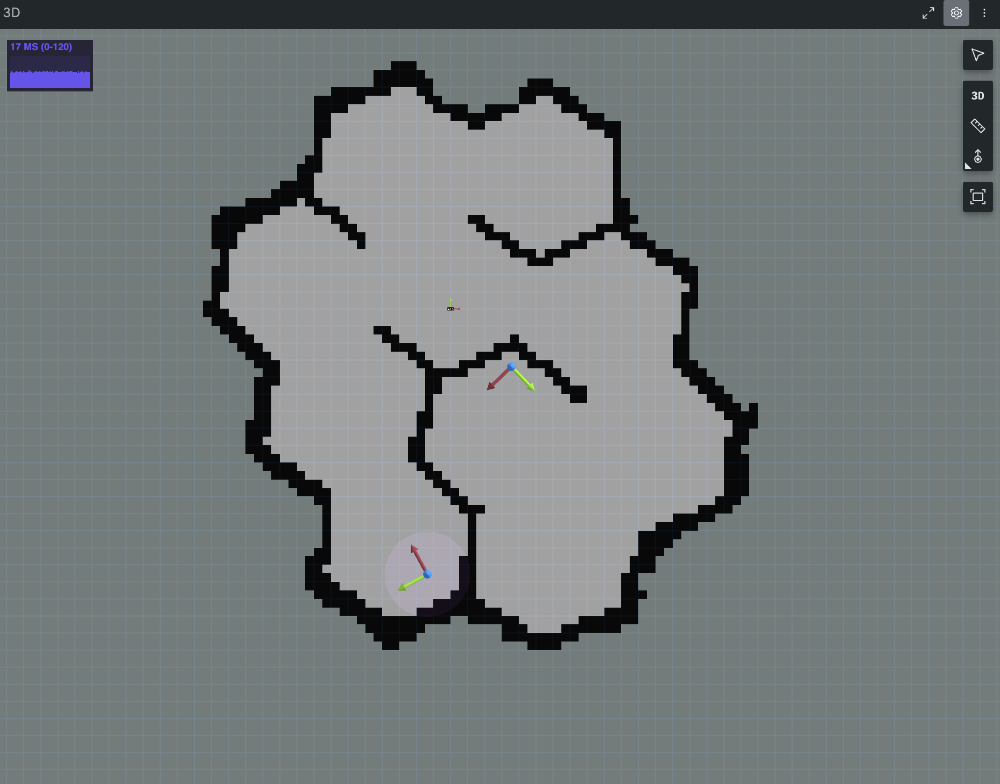
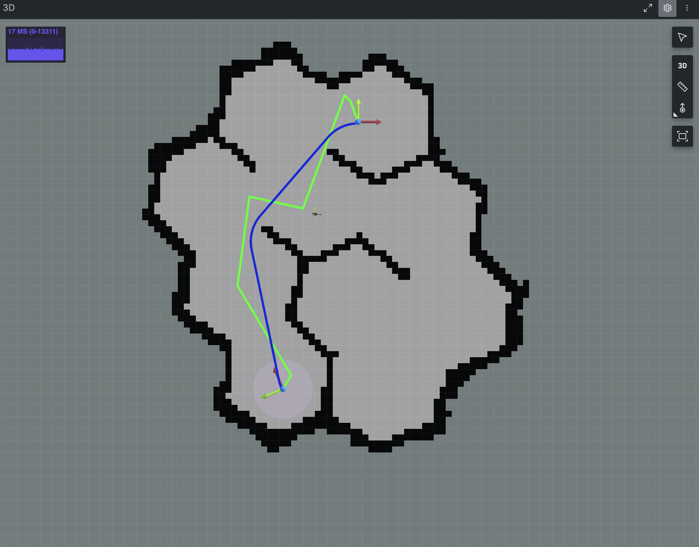

# Project 4: Planning 

Replace this with your own writeup! Please place all figures and answer all questions in this directory.

**Q0** Assembled battery mount:

**Q1.2** A* Shortest Path Figure: 

**Q2.1** RRT Path Figure: ...

**Q3**

A* beats RRT Figure: ...

A* is better than RRT because ...

RRT beats A* Figure: ...

RRT is better than A* because ...

**Q4**

Q4.2

Q4.3

## AI usage (-8 pts if incomplete)
**Did you use AI for this assignment? If so, how was it used? Eiher state "no AI was used" or explain *how* it was used. Failure to complete this section will result in 10% of your grade being lost**

## Feedback

**How much time did you spend on this assignment?**

**Do you have any feedback for this assignment?**
